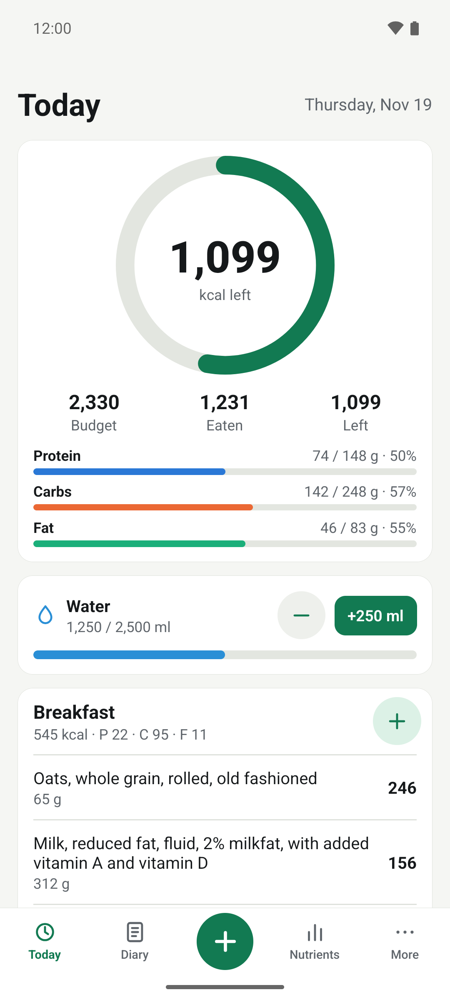
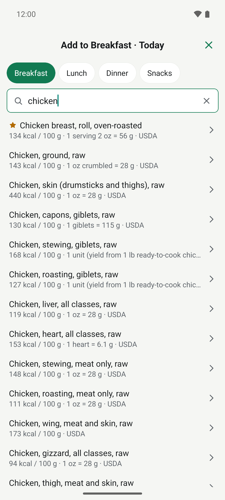
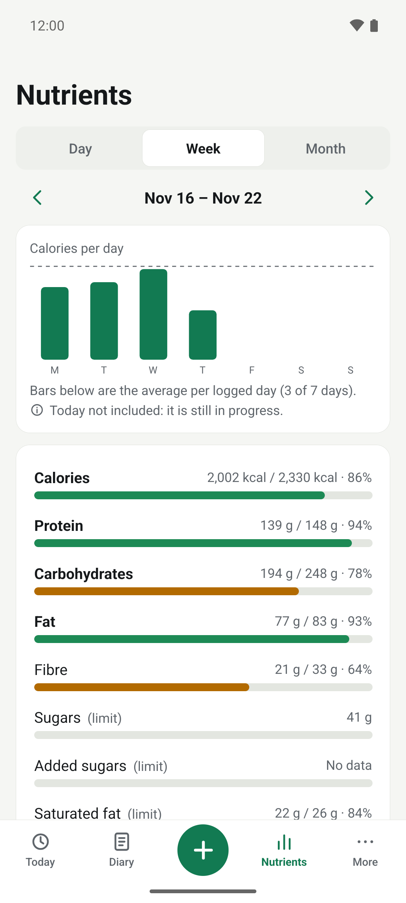
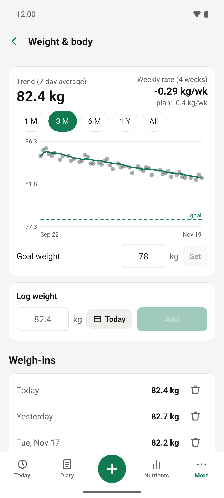
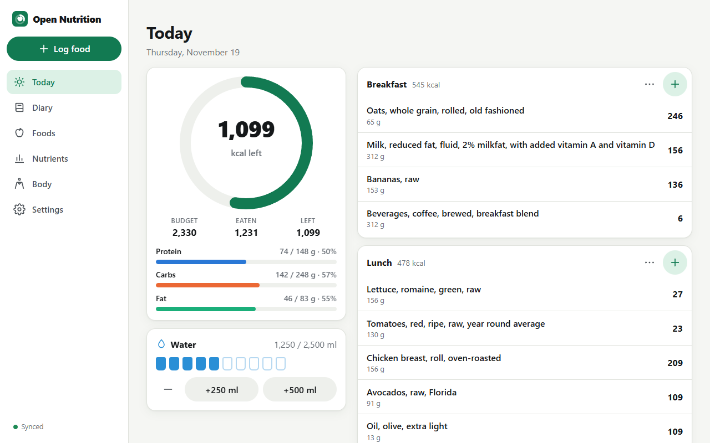

# Open Nutrition

**A free, source-available, self-hostable nutrition tracker.** Log meals on your phone and keep the data on your own server, or only on the phone.

Open Nutrition tracks calories, macros, micronutrients, weight and water, with no paywalls. It is built the same way as Open Workouts: an offline-first mobile app, a thin server, and the same kind of accounts and sync.

- 📱 **Mobile app (iOS + Android, Expo/React Native): the main frontend.**
  - Offline-first; syncs whenever it can reach your server.
  - Also works in local-only mode with no server.
- 🌐 **Web UI** served by the same container: diary, reports and charts from any browser.
- 🐳 **One container, one SQLite file.** Runs on Docker Compose, Kubernetes, or a Proxmox LXC.
- 🥦 **Bundled USDA food database** for offline search with full micronutrient data, plus **barcode scanning** against Open Food Facts.
- ✨ **AI meal logging (optional).** Take a photo and/or describe a meal, and Claude estimates what is on the plate. You review the estimate before anything is saved. Off until you turn it on.
- 🍔 **Restaurant menus (optional, uses AI).** Paste a link to a restaurant's own nutrition page or PDF (or its text); Claude lists the items with the published numbers and you pick which to save as foods.

## Screenshots

<table>
  <tr>
    <td></td>
    <td></td>
    <td></td>
    <td></td>
  </tr>
  <tr>
    <td align="center">Today</td>
    <td align="center">Food search</td>
    <td align="center">Nutrients</td>
    <td align="center">Weight & body</td>
  </tr>
</table>



More in **[docs/SCREENSHOTS.md](docs/SCREENSHOTS.md)**, including the web UI and dark mode.

> Open Nutrition is under active development. The table below is the intended v0.1 feature set, following the phases in [docs/ROADMAP.md](docs/ROADMAP.md).

## Features (v0.1)

| | |
|---|---|
| **Today** | Calorie ring (budget, eaten, remaining), protein/carbs/fat bars, four meal sections, water counter |
| **Add food** | Search (recents and favourites first), barcode scan, photo/describe with AI, quick add, saved meals and recipes |
| **Diary** | Swipe between days; edit, move or copy entries; copy yesterday's breakfast |
| **Nutrients** | Day/week/month report; each nutrient as a bar against its target (under / ok / over); tap a nutrient to see the foods that supplied it |
| **Weight & body** | Weight trend (7-day moving average), weekly rate of change, body fat and circumferences |
| **Targets** | Calories from Mifflin-St Jeor, activity and your goal rate; macros by percentage split or protein g/kg; micronutrients default to US DRIs for your age and sex; every number editable |
| **Food data** | USDA FoodData Central (bundled, offline) and Open Food Facts (barcodes, cached separately). See [Data sources](#data-sources) |
| **AI meal logging** | Claude estimates items and grams; nutrients come from the food database. Server key or your own key on the device. See [docs/AI_MEAL_LOGGING.md](docs/AI_MEAL_LOGGING.md) |
| **Multi-user** | Accounts, per-device tokens you can revoke, API tokens, first user becomes admin |

## Quick start

```bash
git clone https://github.com/ernest-it/open-nutrition.git && cd open-nutrition
docker compose up -d
# open http://<host>:8080 and create your account
```

Then install the app from the [latest release](https://github.com/ernest-it/open-nutrition/releases/latest) and enter `<host>:8080`, or your HTTPS domain if you expose it. Or skip the server and use the app in **local-only mode**: your data stays on the phone. If you set up a server later, sign in from Settings and the app offers to move your local data into your account.

Prebuilt server images are at `ghcr.io/ernest-it/open-nutrition:latest` (amd64 and arm64).

### Environment variables

| Variable | Default | Meaning |
|---|---|---|
| `LLM_PROVIDER` | *(unset)* | Set to `anthropic` to enable AI meal logging on the server |
| `LLM_API_KEY` | | Claude API key (`ANTHROPIC_API_KEY` also works). Stays on the server |
| `AI_MONTHLY_BUDGET_USD` | `25` | Most the whole server may spend on AI in a calendar month, in US dollars. When it is reached, AI stops for everyone until the 1st (`0` = no budget) |
| `AI_MONTHLY_LIMIT` | `150` | Per-user cap on AI requests per calendar month (`0` = unlimited) |
| `AI_DAILY_LIMIT` | `40` | Per-user cap on AI requests per day (`0` = unlimited) |
| `AI_WEB_SEARCH` | `on` | Look up brand-name and restaurant items on the web during an estimate. `off` disables it for everyone |
| `AI_MAX_SEARCHES` | `5` | Most web searches in one estimate (1 to 5). Each search costs about 1¢ plus the text it returns |
| `AI_MAX_CONCURRENT` | `4` | AI requests running at the same time across all users |
| `USDA_API_KEY` | *(unset)* | Optional free [api.data.gov](https://api.data.gov/signup/) key; enables search of USDA packaged (branded) foods and the USDA fallback for barcodes |
| `FOOD_DB_PATH` | `/app/foods.db` (in the image) | Path to the bundled USDA food database |

The full list (ports, registration, proxy, time zone) is in **[docs/DEPLOYMENT.md](docs/DEPLOYMENT.md)**, which also covers Kubernetes, Proxmox, reverse proxies and backups.

### AI and your API key

AI is optional and off by default. On a self-hosted server, put the key in `LLM_API_KEY`; the phone never sees it. In local-only mode you can store your own key in the phone's secure storage. Create a **dedicated key** in a **Claude Console workspace with a monthly spend limit**. Details in [docs/AI_MEAL_LOGGING.md](docs/AI_MEAL_LOGGING.md) and [SECURITY.md](SECURITY.md).

## Development

Requires Node 22+.

```bash
npm install
npm test                 # shared + server test suites
npm run dev:server       # API on :8080 (tsx watch, data in ./data)
npm run dev:web          # web UI on :5173, proxies /api to :8080

cd apps/mobile && npm install
npx expo start           # scan the QR code with Expo Go, or press a / i for emulators
```

In the app, point it at your dev server's LAN IP, e.g. `http://192.168.1.20:8080`.

## Data sources

Food data from [USDA FoodData Central](https://fdc.nal.usda.gov/) (public domain, CC0) and [Open Food Facts](https://openfoodfacts.org/) (database under the [ODbL](https://opendatacommons.org/licenses/odbl/1-0/), contents under the DbCL). Open Food Facts products are cached separately from your own data. See [LICENSING.md](LICENSING.md#data-licenses) and [NOTICE.md](NOTICE.md).

## Documentation

- [docs/ARCHITECTURE.md](docs/ARCHITECTURE.md): monorepo layout, data model, food databases, sync
- [docs/AI_MEAL_LOGGING.md](docs/AI_MEAL_LOGGING.md): the photo/describe flow, models and costs, key options, privacy, eval plan
- [docs/DEPLOYMENT.md](docs/DEPLOYMENT.md): Docker, Kubernetes, Proxmox, HTTPS, backups
- [docs/ROADMAP.md](docs/ROADMAP.md): build order, later ideas, open questions
- [SECURITY.md](SECURITY.md): running a server safely, API keys, reporting vulnerabilities

## License

Open Nutrition is **source-available** under the [PolyForm Noncommercial License 1.0.0](LICENSE).

- **Free for any non-commercial use:** use the app, self-host your own server, change the code, and share it non-commercially.
- **Commercial use needs a separate license.** That covers selling it, paid hosting, or using it to run a business.
- **A paid hosted sync service** is offered by the copyright holder for people who don't want to self-host.
- **Food data has its own licenses**, separate from the code.

See [LICENSING.md](LICENSING.md) for a plain-English summary, [CONTRIBUTING.md](CONTRIBUTING.md) for the contributor agreement, and [NOTICE.md](NOTICE.md) for third-party licenses.
